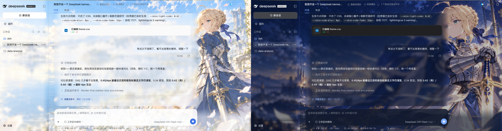
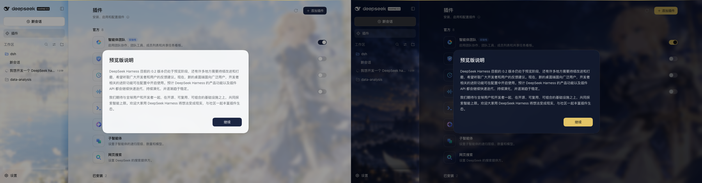
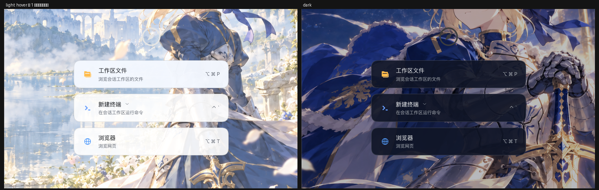
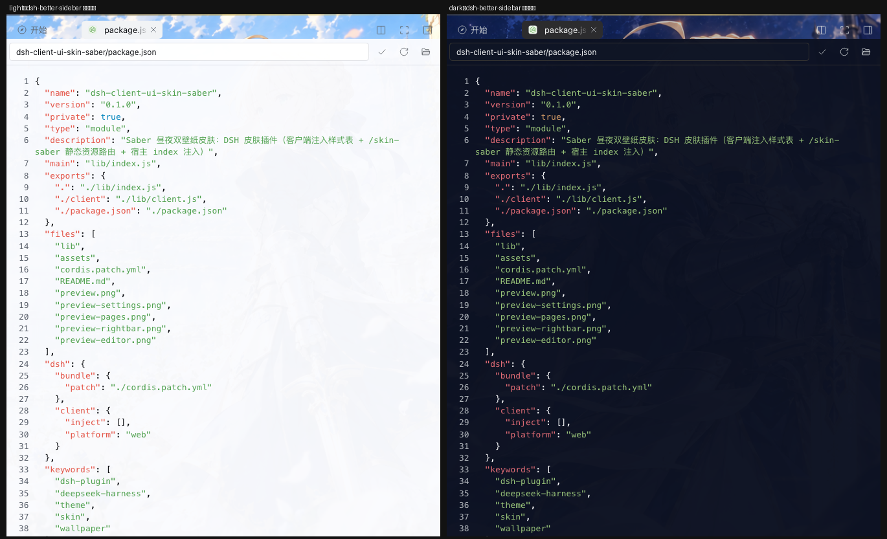
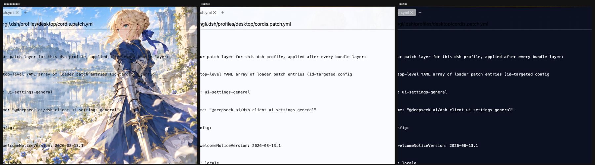
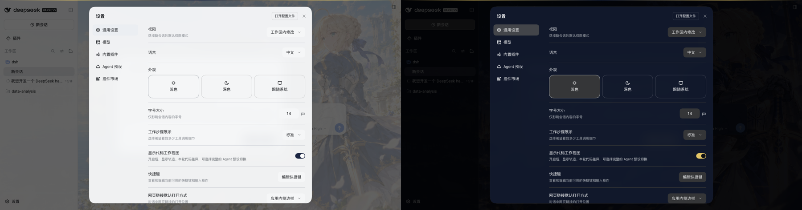

# dsh-client-ui-skin-saber

给 DSH（DeepSeek Harness）Web/桌面端做的**昼夜双壁纸皮肤**：亮色用白天插画、暗色用夜景插画，
自动跟随「外观设置 = 亮色 / 暗色 / 跟随系统」。

长对话（左浅色 / 右深色）——正文落在左侧一块约 820px、几乎只是一层薄纱的阅读底板上（底色 55%），
右侧留白让壁纸里的人物保持清晰；输入卡片与底板左右对齐：



插件页（左浅色 / 右深色）——非会话的整页内容同样铺薄纱，文字不再直接压在壁纸上：



右侧边栏（左浅色 / 右深色）——右栏整条铺薄纱，里面的「工作区文件 / 新建终端 / 浏览器」启动卡才读得清：



第三方插件 `dsh-better-sidebar` 的代码编辑器（真实应用截图，左浅右深）——按插件自己的 `*_editor`
稳定后缀铺近实色底：



文件/代码/文档预览（左：修复前透明 → 中：浅色实底 → 右：深色实底）：



> 这张是用**组件自身的真实 CSS + 主题 token 表**做的合成渲染（不是真实截图）：修复前那格把底色的 alpha 调 0 复现问题，后两格是默认取值。

设置弹窗（左浅色 / 右深色）——对话框面板读 `--dsw-alias-bg-layer-2`，本皮肤把它压到 0.92 并额外给
`[role="dialog"]` 加磨砂，避免壁纸和背后正文透出来、两层文字叠在一起：



> 两张都是**真实应用截图**（用你的本地会话 cookie 在无头 Chromium 里加载正在运行的 DSH 页面拍下来的）。

---

## 1. 快速开始

```sh
# 1) 装进桌面端 profile（会写 ~/.dsh/profiles/desktop，需要能写这个目录）
"/Applications/DeepSeek Harness.app/Contents/Resources/runtime/cli/bin/dsh" \
  plugin --profile desktop add /Users/angl/Documents/dsh/dsh-client-ui-skin-saber

# 这台机器 PATH 里没有 dsh，所以上面用的是应用内置 CLI；
# 已经装过 dsh 命令的话，等价写法是：
#   dsh plugin --profile desktop add /Users/angl/Documents/dsh/dsh-client-ui-skin-saber

# 2) 重启 DeepSeek Harness（插件表的变更在重启后生效）
```

卸载：

```sh
"/Applications/DeepSeek Harness.app/Contents/Resources/runtime/cli/bin/dsh" \
  plugin --profile desktop remove dsh-client-ui-skin-saber   # 然后重启
```

装完可以用一句话确认插件已在表里：

```sh
grep -n "dsh-client-ui-skin-saber" ~/.dsh/profiles/desktop/package.json ~/.dsh/profiles/desktop/cordis.patch.yml
```

## 2. 目录结构

```
dsh-client-ui-skin-saber/
├── package.json        # dsh.bundle.patch + dsh.client —— 一层 profile patch + 一个浏览器 bundle
├── cordis.patch.yml    # insert 一行插件：id=ui-skin-saber
├── lib/index.js        # 宿主半：/skin-saber 静态资源路由 + 给 HTTP index 注入样式表
├── lib/client.js       # 客户端半：在窗口内挂样式表（桌面端唯一可行的注入点）
├── assets/
│   ├── light.png       # 白天壁纸（你的 AM-2.png）
│   ├── dark.png        # 夜晚壁纸（你的 AM-1.png）
│   └── theme.css       # ★ 皮肤本体：配色、壁纸、磨砂都在这里，改它不用重启
├── test/self-check.mjs # 无依赖自检（客户 bundle / 路由 / MIME / 穿越 / index 注入）
├── preview.png         # 主界面预览（模拟渲染）
└── preview-settings.png # 设置弹窗预览（模拟渲染）
```

## 3. 它是怎么实现的

DSH 的 UI 是「宿主进程 + 浏览器端插件图」两层，所以这套皮肤**两端各有一半**——不是设计冗余，
而是两个运行环境取 HTML 的方式不同（见 3.4）：

1. **资源直接读盘** — 宿主半 `ctx.webServer.register({ kind: 'prefix', path: '/skin-saber' })`
   把 `/skin-saber/*` 映射到本包 `assets/`。壁纸不做 base64 塞进 bundle，所以
   - 插件本身极小（客户端 bundle 只有 1.9 KB）、启动零成本；
   - 图片按 `public, max-age=86400` 走浏览器缓存，CSS 走 `no-store` 便于实时改；
   - 想换图就直接替换 `assets/light.png` / `assets/dark.png`。
   路由只服务 GET/HEAD、只放行白名单扩展名，并对 `..`/编码穿越返回 403。

2. **样式表由客户端半挂上** — `lib/client.js` 是 DSH 客户端的 lazy-CJS 约定产物
   （`window.__ModuleLoader__.load({ id, factory })`，与 tsdown 产出的 bundle 同格式），
   它在窗口内 `document.head` 追加
   `<link rel="stylesheet" href="/skin-saber/theme.css?v=<时间戳>">`。
   根相对路径在两种环境都能解析：浏览器 → `http://127.0.0.1:<port>/skin-saber/...`；
   桌面窗口 → `dsh-app://app/skin-saber/...`（被 Electron 转发到本地服务器）。

3. **宿主半额外给 HTTP index 注入** — `lib/index.js` 用 `ctx.webServer.tapIndex()` 在
   HTTP index 响应的 `</head>` 前直接塞同一张 `<link data-skin="saber">`，让
   「`dsh web` + 浏览器直连」的场景**首屏就有样式、不闪原生主题**。
   两边互相去重（客户端半检测到 `link[data-skin]` 就不重复注入），任何环境只加载一次。

4. **改配色借 ui-theme 的别名 token** — `theme.css` 覆盖 `--dsw-alias-bg-base`、
   `--dsw-specific-sidebar-fill`、`--dsw-alias-bg-layer-*` 等语义变量。它们的值是 ui-theme 的
   presenter 以**行内普通声明**写在 `<body>` 上的，而行内普通声明优先级低于样式表里的
   `!important`，所以覆盖必然生效，且不需要碰 ui-theme 的注册表。
   壁纸则画在 `body` 上（`html` 无背景时 body 背景会提升为整个画布），不依赖任何内部 DOM 结构。

5. **正文分层（这张皮肤的关键）** — 遮挡按层分配，而不是整屏加遮罩：

   | 层 | 元素 | 本皮肤的取值 |
   | --- | --- | --- |
   | L0 | `body` 壁纸 | 全屏薄纱 ~0（亮）/ 0.02→0.10（暗），人物保持清晰 |
   | L1 | `.frame` / `.centerCol`（`--dsw-alias-bg-base`） | **0.10 / 0.12**（原来 0.42/0.50 —— 人物被整体蒙白/蒙暗的元凶） |
   | L2 | **阅读底板**：正文列 `[class*='_scroll'] > [class$='_column']` | 亮 `#F5F8FC` @0.55 / 暗 `#0C162A` @0.55，6px 磨砂 + 左右 36px 渐变淡出，**无边框无阴影** |
   | L2 | 左侧栏 `[class*='_sidebarCol']` | 0.62 / 0.60（**单层**）+ 8px 磨砂 + 右缘 32px 淡出 |
   | L2 | **非会话整页**（插件 / 设置 / 轨迹 / 市场）`[class$='_centerCol']:not(:has([class$='_column']))` | 0.62 / 0.58 + 8px 磨砂 |
   | L3 | **第三方编辑器**（profile 插件 `dsh-better-sidebar` 的 CodeMirror 编辑器）`[class$='_editor']` | 0.97 近实色；只在编辑器打开时生效 |
   | L3 | **文件/代码/文档预览**（右栏编辑器）`[data-sidebar-right-panel]:has([data-textpreview-body], …)` | 0.97 近实色；**只有打开预览时生效**，文件树/终端/浏览器标签仍透视 |
   | L2 | **右侧边栏** `[class*='_rightbarCol']` | **默认不铺整栏底**（保持透视）：右栏作用域内 `bg-layer-1` → 0.90（启动卡变实）、`interactive-bg-hover` → 实心高亮（hover 不再掉底） |
   | L2 | 输入卡片 `--dsw-specific-input-major` | 0.96 / 0.95 |
   | L3 | 卡片 / 面板 / 弹窗 / 代码块 | 0.66 / 0.92 / 0.92 / 0.96（接近实色） |

   配套三件事：

   - **阅读列左对齐**：`[class$='_column']{margin-right:auto;margin-left:0}` —— 原来 `margin:0 auto`
     居中，正好压在人物身上；左对齐后右侧 ~300px 全部留给壁纸。
   - **行宽**：`--dsh-chat-user-width`（820px，其中 36px×2 是底板内边距 → 正文约 748px）派生 `--dsh-chat-content-width`
     （默认 `clamp(680px, 列宽*0.64, 920px)`），气泡、代码块与输入卡片都吃这同一个变量。
   - **输入框对齐**：把 `--dsh-composer-card-max-width` 设成与阅读列同宽，并把输入卡片容器
     `[class*='_composerStack'] [class$='_root']` 改成 `align-items:flex-start` +
     左内边距 = 阅读列的 `padding-left`（实测两者左右边界都在 x=312 / 1092）。

   **首页（`data-phase="hero"`）不铺底板**：此时正文列根本不存在，壁纸完整展示，
   只有输入卡片是实色 —— 正好是「新会话首页只突出输入框」。

   还有一类表面容易漏掉：**非会话的整页内容**（插件页、设置页、轨迹、插件市场）。它们挂在同一个
   正文列里，却既没有阅读列也没有 `data-phase`，实测容器（插件页的 `ZVcBiW_page`）背景是透明的，
   文字会直接压在壁纸上。`theme.css` 第 4.6 节用一条通用规则兜住：
   正文列里「没有会话阅读列」且「不是 hero」时，整列铺同族薄纱 + 磨砂 —— 以后新增的整页自动享受。

明暗切换走 `body[data-ds-dark-theme]`：这个属性由宿主启动脚本 + 布局 presenter 按解析后的
配色方案设置，所以三种偏好（亮色/暗色/跟随系统）都自动适配。

### 3.1 为什么必须有客户端半（桌面端踩到的坑）

桌面端窗口的文档是 Electron 的 `dsh-app://app` 自定义协议，主进程里的处理器长这样：

```js
if (pathname === "/" || pathname === "/index.html"
    || pathname.startsWith("/assets/") || favicon/manifest) {
  return serveWebDocument(request, .../dsh-web-frontend/dist)   // ← 从磁盘读，绕过 index 转换
}
return forwardWebRequest(request, hostUrl, hostCookie)          // ← 其余路径转发给本地 DSH 服务器
```

结论：

- 桌面窗口的 `index.html` **不是**由本地 Web 服务器渲染的，所以
  `ctx.webServer.tapIndex()` 在桌面端**永远不会执行** —— 只靠宿主半的话，重启多少次都没效果；
- 但 `/plugins/<id>/client.js`、`/api/*`、`/skin-saber/*` 这类路径**会被转发**给本地服务器，
  所以客户端 bundle（由插件图加载）是桌面端唯一可靠、且不需要内联 base64 的注入点；
- 这也解释了为什么社区主题（如 `dsh-client-ui-skin-real-madrid`）都写成客户端插件：
  它们的图片是 base64 内联进 bundle 的。我们这里因为转发通道覆盖任意路径，
  可以把图片留在磁盘上按普通 HTTP 资源提供。

### 3.2 关键的现实约束（实测数据，0.2.0-rc.2 桌面端）

- **`data-platform` 未设置** → ui-layout 里那些 `[data-platform=darwin]` 变体在这个构建里
  **都不生效**：`.frame` 就是 `background: var(--dsw-alias-bg-base)`（全窗口铺底），
  `.centerCol` 没有自己的底色，侧栏也没有 `color-mix` 二次乘透明度。
  所以 token 是按 1:1 生效的，想让侧栏更实直接加 `--skin-*-side` 就行（不必补偿乘法）。
- **遮挡必须放在 L2/L3 层**：`.frame` 的 `bg-base` 覆盖整个窗口（包括人物所在的右侧），
  它一旦给大就必然连人物一起蒙掉 —— 这正是「文字看不清」和「人物被蒙」同时出现的原因。
- **正文往上到底有几层底色（实测）**：底板（渐变 + 6px 磨砂）→ `ST7X_W_root` 的 `bg-base` 0.12
  → `.frame` 的 `bg-base` 0.12 → `body` 壁纸。**消息列表自身（`_scroll` / `_root` / `_flowItem` /
  `_markdown` / 容器）全是透明的**，不存在「列表又刷一层底色」把画面压实的隐患；
  唯一叠加的是 `bg-base` 被画了两次（合成 ≈1-(0.88×0.88)≈0.23，很轻）。
  想再透一点就继续减 `--skin-{light,dark}-frame`，而不是动别处。
- **侧栏原本是两层同一个 token 叠加**：`_6Qf49G_sidebarCol` 与侧栏插件自己的
  `_3WPZCG_root` 都铺 `--dsw-specific-sidebar-fill`，合成 ≈1-(1-0.88)²≈**98% 不透明**
  —— 这就是它像实心板、壁纸完全看不见的原因。本皮肤把内层置透明（
  `[class*='_sidebarCol'] [class*='_root']`），所以 `--skin-*-side` 的值＝实际看到的 alpha。
- **底板只改底色 alpha，不用 `opacity`**：`opacity` 会连文字一起变淡。左右淡出用底色渐变实现，
  且横向 padding 取同一个变量，保证文字不会落在半透明的边上。
- **`--dsh-chat-content-width` 可覆盖**：默认 `clamp(680px, 列宽*0.64, 920px)`；
  想控制行宽就设 `--skin-read-width`，窄窗口由 `width:100%` 自动收缩（实测 1000px 窗口正常）。
- **0.1.0-rc.5 → 0.2.0-rc.2 的 token 有增补**（例如 `--dsw-alias-bg-document-preview`、
  `--dsw-menu-surface-fill`、`--dsw-alias-link`）。本皮肤只覆盖两版都存在的 token。

## 4. 迭代循环

| 改什么 | 要做什么 |
| --- | --- |
| `assets/theme.css`（配色、薄纱、磨砂、壁纸位置） | 保存 → 重开窗口 / 刷新页面。**不用重启 DSH** |
| 换 `assets/light.png` / `dark.png` | 同上（CSS 里带 `?v=时间戳`，图片按天缓存，必要时硬刷新一次） |
| `lib/client.js` | 重启 DSH（客户端 bundle 由插件图在启动时组装） |
| `lib/index.js`、`package.json`、`cordis.patch.yml` | 重启 DSH（插件表 / `dsh.client` 声明只在重启时重扫） |

自检（不安装也能跑，用 mock 响应接流，不监听端口）：

```sh
node test/self-check.mjs
```

改完 CSS 也可以先用 lightningcss 过一遍语法（DSH 源码里带了这个依赖）：

```sh
cd ~/github/deepseek-harness && node --input-type=module -e "
import { transform } from 'lightningcss'
import { readFileSync } from 'node:fs'
console.log(transform({ filename: 'theme.css', code: readFileSync('/Users/angl/Documents/dsh/dsh-client-ui-skin-saber/assets/theme.css') }).warnings)
"
```

## 5. 调参

全部旋钮集中在 `assets/theme.css` 顶部 `:root`：

| 旋钮 | 作用 | 感觉不对时怎么调 |
| --- | --- | --- |
| `--skin-{light,dark}-board` | ★**正文阅读底板**底色 alpha（亮/暗都 0.55） | 文字还是飘 → 加大到 0.60~0.65；还觉得实 → 继续减 |
| `--skin-{light,dark}-board-blur` | 底板背后磨砂（默认 **6px**，保留壁纸轮廓） | 想更糊 → 10~16px；想更清晰 → 3px / 0px |
| `--skin-board-fade` | 底板左右渐变淡出宽度（36px，建议 32~48） | 边界太硬 → 加大；文字贴边 → 与底板横向 padding 同值即可（本皮肤就是同一个变量） |
| `--skin-read-width` | 阅读列宽度（默认 820px，含左右各 36px 内边距） | 正文横跨人物 → 减小 |
| `--skin-{light,dark}-frame` | 主框架底色（bg-base，亮 0.10 / 暗 0.12） | **人物被蒙就减它**；空区域太空 → 略加 |
| `--skin-{light,dark}-veil-top/bottom` | 全屏薄纱渐变（≈0） | 只在想整体调氛围时动，别用来压文字 |
| `--skin-{light,dark}-side` | 侧栏底色 alpha（0.62 / 0.60，**单层**） | 会话名不好扫读 → 加大到 0.75~0.85；想更透 → 减 |
| `--skin-side-fade` / `--skin-side-blur` | 侧栏右缘淡出（32px）/ 磨砂（8px） | 与正文列的分界太硬 → 加大 fade；会话名发飘 → 加大 blur |
| `--skin-{light,dark}-input` | 输入卡片（0.88 / 0.85） | 首页只突出输入框就靠它 |
| `--skin-{light,dark}-panel` | 面板 / **对话框**底（layer-2，0.92） | 设置弹窗看不清 → 加大 |
| `--skin-{light,dark}-menu` | 菜单、弹层（layer-3 / overlay，0.94） | 菜单透出正文 → 加大 |
| `--skin-{light,dark}-mask` / `-mask-soft` | 模态遮罩浓度（0.38/0.20，暗 0.56/0.28） | 弹窗背后太花 → 加大 |
| `--skin-{light,dark}-card` | 卡片（layer-1，0.66） | 正文里的卡片太实 → 减小 |
| `--skin-{light,dark}-code` | 代码块（0.94 / 0.93，接近实色） | 代码要更稳 → 加大 |
| `--skin-{light,dark}-page` / `--skin-page-blur` | 非会话整页内容的薄纱（0.62 / 0.58）+ 磨砂（8px） | 插件页/设置页文字压背景 → 加大；想更透 → 减 |
| `--skin-{light,dark}-rightbar` | 右侧边栏整条薄纱（**默认 0 = 只压实卡片**，不铺整栏底） | 想让整条右栏也蒙一层 → 0.4~0.62；右栏里的卡片想更实 → 改第 4.7 节的 0.90 |
| `--skin-{light,dark}-preview` | **文件/代码/文档预览 + 第三方编辑器**的底（0.97，接近实色） | 代码还是发虚 → 加；想透一点 → 减到 0.9 |
| `--skin-frame-blur` | 主框架全局磨砂，**默认 0px** | 打开会把人物一起糊掉，除非你要整屏玻璃感 |
| `--skin-saturate` | 磨砂同时的饱和度 | 画面发灰时 1.1~1.2 |
| `--skin-accent-{light,dark}` | 主按钮 / 强调色 | 换成你喜欢的品牌色 |
| `--skin-position` | 壁纸对齐（`center center` / `70% center` …） | 角色/主体被裁掉时 |

**调参顺序**（照这个顺序改，别一上来动全屏遮罩）：

1. 文字与背景分不开 → 加 `--skin-*-board`（底板），必要时加 `board-blur`；
2. 人物被蒙/泛白 → 减 `--skin-*-frame`，并确认 `--skin-frame-blur: 0px`；
3. 正文行宽压到人物 → 改 `--skin-read-width`；
4. 侧栏/输入框等仍不够稳 → 单独加对应的 `side` / `input` / `panel`。

## 6. 可选升级

### 6.1 想要「可切换 / 可关闭」的开关

client 半已经在了（`lib/client.js`），加开关只需在它的 factory 里挂一个监听，控制那张
`<link id="__dsh-skin-saber-stylesheet__">` 的去留：

```js
// 在 lib/client.js 的 factory 内追加：⌘F9 切换皮肤
document.addEventListener('keydown', (event) => {
  if (!(event.metaKey && event.key === 'F9')) return
  const link = document.getElementById('__dsh-skin-saber-stylesheet__')
    ?? document.querySelector('link[data-skin="saber"]')
  if (link !== null) link.remove()
  else mount()   // 重新挂上；想更省事就只删除、刷新页面即恢复
})
```

想做「设置里可勾选」的开关，就在同一个 bundle 里用 `ctx.slots`/`ctx.settingsScope` 挂一个设置行
（参考 `@deepseek-ai/dsh-client-ui-theme` 的 `AppearanceRow`）。注意：改 `lib/client.js`
之后需要**重启 DSH** 才会重新组装客户端 bundle。

参考：社区皮肤 `dsh-client-ui-skin-real-madrid`（纯 client 半、图片 base64 内联）与
`dsh-client-ui-aqua-patched`（玻璃质感、带总开关）。

### 6.2 想走官方主题 API（`ctx.theme.register` / `overrideTokens`）

client 半可以 `export const inject = ['theme']`，然后：

```js
ctx.theme.overrideTokens('dsh-client-ui-skin-saber', {
  '--dsw-alias-bg-base': { light: 'rgb(255 255 255 / 0.42)', dark: 'rgb(11 16 30 / 0.50)' },
})
```

好处是不用 `!important`、能和「跟随系统」自动配对明暗值、可撤销。
**已知限制**：`register()` 注册的自定义主题不会出现在「设置 → 外观」那三个格子里
（`AppearanceRow` 只渲染 light/dark/system），所以要让用户可选，得自己再挂一个设置项。
壁纸那一层仍然只能靠注入 CSS —— token 只覆盖变量，无法表达 `background-image`。

## 7. 排查

| 现象 | 原因 / 处理 |
| --- | --- |
| 完全没变化 | 插件表 / `dsh.client` 声明只在重启时重扫 → 重启 DSH；确认 profile 里有这个包：`~/.dsh/profiles/desktop/package.json` 的 `dependencies` 与 `dsh.profile.bundles` |
| **重启了还是没变化（桌面端）** | 桌面窗口的 index 从磁盘读，宿主 `tapIndex` 到不了那里 —— 需要 `lib/client.js` 这个客户端半（本仓库已含）。装好客户端半后**再重启一次**；仍是旧样子说明窗口里的文档是旧的，关掉窗口重开 |
| 图片 404 | 看 DevTools Network 里 `/skin-saber/light.png` 的状态（桌面端是 `dsh-app://app/skin-saber/light.png`，由 Electron 转发）；确认 `assets/` 里有文件、扩展名在白名单内（png/webp/jpg/avif/svg/woff2/css） |
| 改了 CSS 没反应 | 关掉窗口重开 / 刷新页面（CSS 走 `no-store` + `?v=时间戳`，理论上不会缓存） |
| 某个面板还是不透 | 见 `theme.css` 第 9 节的 `[class*='_...Col']` 强制透明写法 |
| 弹窗/设置看不清（背后文字透出来） | 对话框 = `[role="dialog"]` + `--dsw-alias-bg-layer-2`；把 `--skin-*-panel` 调大、`--skin-*-mask` 调大，第 6 节已经把面板压到 0.92 并加了磨砂 |
| 文字和背景分不开（长对话） | 加 `--skin-*-board`；底板没生效先查 `data-phase` 是不是 `active`（首页态本来就不铺底板） |
| 人物被蒙白 / 蒙暗 | 减 `--skin-*-frame`（主框架底色），并把 `--skin-frame-blur` 保持 `0px`；遮挡只应来自 L2/L3 |
| 正文横跨人物 | 改 `--skin-read-width`（720~820）；确认阅读列是左对齐而不是居中 |
| 插件页/设置页文字压在壁纸上 | 由第 4.6 节的通用规则兜住；加大 `--skin-{light,dark}-page`，或看该页容器是否漏了（用第 8 节第 3 条的方法抓一下 `_centerCol` 的计算值） |
| 右侧边栏的启动卡发虚（工作区文件/新建终端/浏览器） | 第 4.7 节只在右栏作用域内把 `bg-layer-1` 提到 0.90；卡片还不够实就改那里的 0.90；想给整条右栏加底 → `--skin-{light,dark}-rightbar: 0.5` |
| **第三方插件**（dsh-better-sidebar）的代码编辑器透明 | 该插件自带的编辑器容器 `*_editor` 没有底色；第 4.9 节按稳定后缀 `[class$='_editor']` / `[class$='_pane']:has(…)` 铺底。插件改用别的类名时，把新类名加进那条选择器即可 |
| 打开文件/配置文件后，代码直接压在壁纸上 | 预览组件（`ui-sidebar-documentpreview` 的 TextPreview）正文 `[data-textpreview-body]` **本身没有底色**，默认主题靠不透明面板兜住；第 4.8 节已按「打开预览才铺近实色底」处理，还不够实就加 `--skin-{light,dark}-preview` |
| 右栏卡片 **hover 时变成空描边** | 应用的 hover 是**替换**背景成 `--dsw-alias-interactive-bg-hover`（原主题只有 8% 淡色），在无底壁纸上就等于掉底；第 4.7 节已在右栏作用域内把它换成实心高亮（`0.97`），要换色改那两行即可 |
| 输入框与正文没对齐 | 两者都由 `--dsh-chat-content-width` 派生：检查 `--skin-read-width`，以及 `[class*='_composerStack'] [class$='_root']` 的 `align-items`/`padding-left` |
| 想彻底还原 | 卸载插件并重启；皮肤没有改任何持久化设置 |

### 排查用的两个现成手段

1. 宿主路由是否活着（插件是否已加载）——不用登录、不受鉴权影响：

   ```sh
   curl -s -o /dev/null -w "%{http_code} %{content_type} %{size_download}\n" \
     http://127.0.0.1:19387/skin-saber/theme.css     # 期望 200 text/css 11xxx
   ```

2. 页面里样式表是否落地 —— 开 DevTools（桌面端 F12）→ Elements 看 `<head>` 里有没有
   `<link ... data-skin="saber">` 或 `<link id="__dsh-skin-saber-stylesheet__">`；Console 里
   搜 `skin` 有没有报错；Elements 里选中 `<body>` 看 Computed 的 `background-image`
   是否等于 `/skin-saber/light.png`。

3. 正文分层是否落地 —— 在 Console 里跑（`_column` 应报出宽度 780、背景是半透明板、
   margin-right 是 auto 算出的正数）：

   ```js
   const col = document.querySelector('[class$="_column"]')
   const cs = getComputedStyle(col)
   ({ w: col.clientWidth, bg: cs.backgroundColor, blur: cs.backdropFilter, mr: cs.marginRight })
   ```

## 8. 兼容性

- 开发验证环境：DSH 桌面端 **0.2.1-rc.3**（皮肤同时兼容 0.2.0-rc.2；0.2.1 新增的文件预览/编辑器
  由第 4.8 节处理）。本地 `~/github/deepseek-harness` 源码是 0.1.0-rc.5，比已安装版本旧，
  token 清单与 DOM 结构都以**已安装版本实测**为准。
- 实测过的结构钩子：`[data-phase]`、`[data-content-phase]`、`[class*='_scroll']`、
  `[class$='_column']`、`[class*='_composerStack'] / [class$='_root'] / [class$='_card']`、
  `[class*='_composerSeat']`、`[class*='_sidebarCol']`、`[class*='_rightbarCol']`、
  `[data-sidebar-right-panel]`、`[data-textpreview-body]` / `[data-textpreview-path]`、
  `[class$='_editor']` / `[class$='_pane']`（第三方编辑器插件，按稳定后缀匹配）、
  `[role='dialog']`。
  其中 `data-*` 语义属性最稳（跨版本不变）；`[class*=…]` 是 CSS Module `<hash>_<local>` 的后缀匹配，
  DSH 大改内部结构时按第 7 节的方法用 Console 重抓一遍即可。
- 桌面端 `<->` 浏览器的差异来自 Electron 主进程的 `dsh-app://` 协议处理器（见 3.1）；
  客户端半是唯一同时覆盖两种环境的注入点。
- 不引入新依赖、不改任何组件代码、不需要构建工具。

## 9. 打包、发布与换机安装

这个插件**没有构建步骤**（`lib/index.js`、`lib/client.js` 都是手写产物并已提交），
所以拿到源码 / 包就能直接跑。下面三种方式按「省事 → 正规」排列。

### 9.1 直接拷目录（最快，不上传任何东西）

另一台机器上：

```sh
# 1) 把整个 dsh-client-ui-skin-saber/ 拷过去（U 盘 / 网盘 / scp 都行）
#    注意 assets/ 里就是两张壁纸和 theme.css，别漏
# 2) 装进 profile
dsh plugin --profile desktop add /path/to/dsh-client-ui-skin-saber
#    本机 PATH 没有 dsh 的话用应用内置 CLI：
#    "/Applications/DeepSeek Harness.app/Contents/Resources/runtime/cli/bin/dsh" \
#      plugin --profile desktop add /path/to/dsh-client-ui-skin-saber
# 3) 重启 DSH
```

这台机器现在就是这么装的（profile 里是一条 `link:`，改本地文件即可生效）。

### 9.2 GitHub 仓库（✅ 已发布，推荐）

仓库：**<https://github.com/IanGely/dsh-client-ui-skin-saber>**（public，已打 tag `v0.1.0` + Release）。
本机已配置好远端，以后改完 `git add -A && git commit && git push` 即可。

另一台机器（需要 git）：

```sh
# 固定版本（推荐）
dsh plugin --profile desktop add github:IanGely/dsh-client-ui-skin-saber#v0.1.0
# 跟最新 main
dsh plugin --profile desktop add github:IanGely/dsh-client-ui-skin-saber
# PATH 没有 dsh 就用应用内置 CLI（见 9.1）
```

更新插件：改完本地 → `git push` → 另一台重新执行上面的 `add`（pnpm 会拉新 commit），然后重启 DSH。

小提示：

- `package.json` 里的 `"private": true` **不影响** git 安装（它只挡 npm publish），已实测
  `pnpm add github:IanGely/dsh-client-ui-skin-saber#v0.1.0` 可正常安装；
- git 安装会用 `files` 白名单打包，`test/` 不会进依赖目录，`lib/` + `assets/` + `cordis.patch.yml` 齐全；
- 仓库约 8.5 MB，主要是两张壁纸 + 预览图。

### 9.3 发布到 npm（`dsh plugin add <包名>`，最规范）

`dsh-client-ui-skin-saber` 这个名字在 npm 上**还没被占用**（查过是 404）。

```sh
cd dsh-client-ui-skin-saber
# 1) 把 package.json 里的 "private": true 删掉（npm 拒收 private 包）
# 2) 登录并发布
npm login
npm publish --access public        # 或 pnpm publish --access public
```

另一台机器：

```sh
dsh plugin --profile desktop add dsh-client-ui-skin-saber          # 最新
dsh plugin --profile desktop add dsh-client-ui-skin-saber@0.1.0    # 固定版本
```

发 npm 前建议顺手补两行（可选，`npm publish` 会提示缺 repository）：

```json
"repository": { "type": "git", "url": "git+https://github.com/IanGely/dsh-client-ui-skin-saber.git" },
"homepage": "https://github.com/IanGely/dsh-client-ui-skin-saber#readme"
```

⚠️ **改包名要三处一起改**：`package.json` 的 `name`、`lib/client.js` 里
`window.__ModuleLoader__.load({ id: … })` 的 `id`、`cordis.patch.yml` 里的 `name:`。
三处不一致会报 "… 不是 client 包" 或客户端 bundle 不加载 —— 所以第一次发布建议**直接沿用现在的名字**。

### 9.4 换机后怎么验证

```sh
# 1) 插件是否在 profile 里
grep -n "dsh-client-ui-skin-saber" ~/.dsh/profiles/desktop/package.json \
                                   ~/.dsh/profiles/desktop/cordis.patch.yml

# 2) 宿主路由是否活着（端口换成 dsh web 打印的地址）
curl -s -o /dev/null -w "%{http_code} %{content_type}\n" \
  http://127.0.0.1:<port>/skin-saber/theme.css     # 期望 200 text/css
```

然后重启 DSH；之后只改 `assets/theme.css` 就只需刷新页面。

### 9.5 卸载

```sh
dsh plugin --profile desktop remove dsh-client-ui-skin-saber    # 然后重启
```

### 9.6 版本兼容提醒

皮肤的 DOM 钩子按 **0.2.1-rc.3** 实测（本机现在是 0.2.2-rc.1，仍可用）。另一台机器如果 DSH
版本差得多，个别表面的钩子可能不匹配（表现为某处又变透明/变实），按第 7 节用 Console 重抓类名
补进 `theme.css` 即可 —— 主题只做样式覆盖，不会让 DSH 起不来。

### 9.7 包体积

`pnpm pack` 出来的 tarball 约 **8.3 MB**：两张壁纸 4.5 MB + 预览图 3.5 MB + 代码 100 KB。
想让包小一点：把 `package.json` 的 `files` 里 `preview*.png` 去掉（npm 包变 ~4.7 MB），
或者把壁纸转成 WebP（通常能压到 300–500 KB/张，但要同步改 `theme.css` 里的文件名）。
